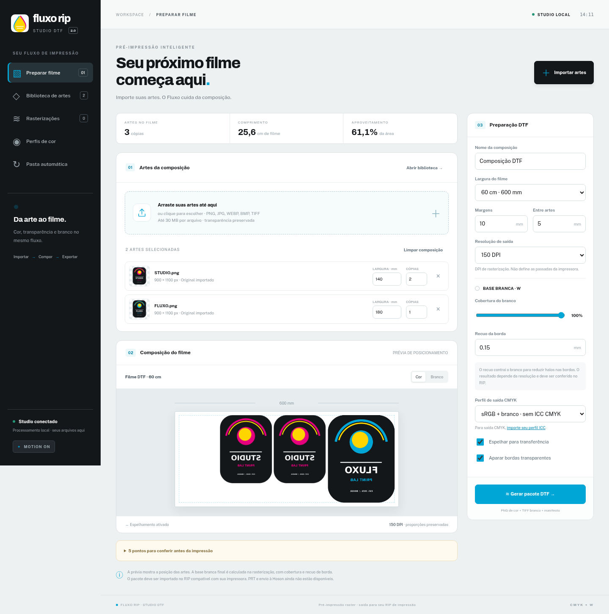

# Fluxo RIP · Studio DTF 2.0

Preparação automática de imagens para DTF, com interface em português, composição no filme, gerenciamento de cor por ICC e separação de branco. O Studio passa a ser a tela inicial do programa.



## O que está implementado

- Importação múltipla e arrastar/soltar de PNG, JPEG, WEBP, BMP e TIFF RGB, preservando os bytes originais e a transparência.
- Biblioteca paginada com busca em todo o acervo, sem distinção de acentos, inspeção de alfa/ICC e remoção de fundo chapado em uma nova revisão.
- Tamanho físico em milímetros com proporção preservada, rotação em passos de 90°, cópias, margens e espaçamento.
- Composição automática por prateleiras, ordenada por altura, com divisão de filmes longos em páginas sem cortar artes. É um arranjo determinístico, sem promessa de aproveitamento ótimo.
- Recorte das bordas transparentes, espelhamento do filme inteiro e saída a 150, 300 ou 600 DPI.
- Avisos de resolução efetiva baixa, entrada sem perfil e fundo opaco.
- Branco derivado do alfa, com cobertura de 0–100% e recuo da borda de 0–1 mm.
- Conversão de perfis RGB incorporados para sRGB e saída CMYK quando um ICC CMYK válido é fornecido pelo operador. O branco continua como máscara independente.
- Provas reduzidas dos rasters finais de cor e branco, com download individual de cada separação por página.
- Histórico de rasterizações com busca por nome/ID e paginação em todo o acervo, mantendo o contador global de trabalhos ativos.
- Fila persistente, processamento sequencial fora da requisição HTTP, progresso por etapas reais, cancelamento, histórico e reutilização da composição.
- Pasta automática opcional: aguarda estabilidade por pelo menos seis segundos, importa uma vez cada versão do arquivo e gera um pacote por imagem.
- Aba PrintExp: vínculo opcional à pasta local, leitura das listas TSKF 24, contagem de registros e consulta das opções de comunicação, preservando os arquivos da instalação.
- Fontes Archivo/Public Sans incluídas com licença OFL, sem carregamento externo no Studio.
- Interface responsiva, rascunho local, reconexão automática, navegação voltar/avançar do navegador e atalhos de importação (`Ctrl+O`), animações com controle e respeito ao movimento reduzido do sistema.

## Limite operacional

**Esta versão faz pré-impressão raster; ainda não substitui um RIP de dispositivo homologado.** Ela não gera PRT de produção, não aplica retícula específica de controladora e não envia trabalhos ou comandos a PrintExp/Hoson. A investigação de formatos proprietários permanece isolada em `research/autorip-studio`, sem alteração nesta entrega.

O pacote ZIP contém:

| Arquivo | Conteúdo |
| --- | --- |
| `cor_sRGB.png` | Cor com alfa, perfil sRGB incorporado e DPI |
| `branco_W.tif` | Máscara de branco em cinza; 0 = sem tinta, 255 = cobertura máxima |
| `cor_CMYK.tif` | Presente quando há ICC CMYK: cor convertida, canais modulados pelo alfa, perfil e DPI incorporados |
| `manifesto.json` | Dimensões, posições antes do espelhamento, parâmetros, avisos e hashes dos rasters |
| `LEIA_ANTES_DE_IMPRIMIR.txt` | Orientações para importação no RIP de destino |

A máscara W **não é um canal spot automaticamente reconhecido pela impressora**. Associe as separações em um RIP compatível e confira dimensões, branco, retícula, orientação e calibração. Se o pacote já foi espelhado, evite espelhá-lo novamente. O ICC deve corresponder à operação real; validar o arquivo com LittleCMS não homologa a impressão.

## Executar pelo código-fonte

Python 3.12 x64 recomendado:

```bash
python -m venv .venv
# Windows: .venv\Scripts\activate
# Linux: source .venv/bin/activate
python -m pip install -r requirements.txt
python -m uvicorn app.main:app --host 127.0.0.1 --port 8765
```

Abra `http://127.0.0.1:8765`. Também é possível usar o launcher e o instalador existentes. Para compilar no Windows 10/11 x64, execute `GERAR_EXECUTAVEL.bat`; o código continua usando `FORGE.spec` para gerar `dist/FluxoRIP.exe`.

**Há uma prévia EXE compilada pelo GitHub Actions em Windows Server 2022**, com autoteste HTTP local. Baixe o artefato `FluxoRIP-Studio-DTF-Windows-x64-preview` no workflow **Studio DTF checks** do PR. Isso não comprova execução em Windows 10/11 ou impressão física; esses testes continuam pendentes.

## Fluxo de uso

1. Importe as artes e defina largura física e quantidade de cada uma.
2. Escolha filme, DPI, margens, branco e espelhamento.
3. Confira a composição e abra os avisos de pré-impressão.
4. Opcionalmente, importe seu ICC CMYK em **Perfis de cor** e selecione-o na preparação.
5. Clique em **Gerar pacote DTF** e acompanhe **Rasterizações**.
6. Baixe o ZIP e importe as separações no RIP de impressão compatível.

Na preparação, **Cor / Alfa** mostra o posicionamento e a transparência. Depois de rasterizar, **Conferir separações** abre provas reduzidas dos rasters finais de cor e branco; a prova W já inclui o recuo e a cobertura aplicados. As provas não simulam a resposta de cor física da impressora e não devem ser usadas como arquivos de impressão.

Defina o **Comprimento máximo por página** para limitar cada arquivo. O limite efetivo também depende do DPI e da largura do filme, mantendo até 40 MP por página. Se o trabalho precisar de várias páginas, o ZIP organiza os rasters em `filme_001/`, `filme_002/` etc. A pasta `previas/` contém apenas provas reduzidas. O comprimento do painel soma as páginas; o navegador da composição permite conferir cada uma. A largura de uma arte é definida **antes da rotação**; a altura acompanha a proporção.

TIFFs com mais de uma página e WEBPs animados devem ser separados em imagens estáticas antes da importação; o aplicativo rejeita esses arquivos para evitar descartar páginas silenciosamente.

### Pasta automática

Em **Pasta automática**, informe uma pasta existente no computador servidor, a largura física de cada arte e ative a observação. Os parâmetros atuais de **Preparar filme** são copiados para essa configuração. Alterar a tela posteriormente não muda a automação até ativar novamente.

Arquivos já presentes também entram no fluxo. Não há recursão nem leitura de links simbólicos. O monitor verifica tamanho/data em duas observações separadas por seis segundos; um produtor que pause a escrita por mais tempo pode parecer estável. Para cópias demoradas, grave com extensão temporária e renomeie só ao concluir. Cada versão é identificada por caminho, tamanho e data; alterar o arquivo permite nova importação. Erros de imagem são registrados uma vez por versão. Desativar a pasta impede novas entradas; trabalhos já enfileirados continuam na fila.

Os pacotes ficam em `dtf_exports` dentro da pasta de dados. A automação não altera a entrada nem copia arquivos para a pasta do PrintExp.

## PrintExp em leitura

Abra **PrintExp**, informe a pasta absoluta da instalação no computador que executa o Fluxo RIP (contendo `Project.ini` e `Data`) e clique em **Vincular para leitura**. Também é possível selecionar uma cópia da instalação para análise. **Atualizar leitura** consulta novamente os arquivos; **Desvincular** apaga o vínculo salvo no Fluxo.

São lidos `fileTask.tf`, `printTask.tf`, `HistoryTask.tf` e `recordTask.tf`, com até 30 nomes por arquivo e a contagem total de registros. Esses registros podem estar antigos ou repetidos. Não são telemetria física e não alteram o histórico de rasterizações do Studio. A integração não inicia executáveis, carrega DLLs, abre conexões com a placa ou escreve na instalação do PrintExp.

O suporte foi verificado com arquivos TSKF versão 24 fornecidos pelo operador. Formatos diferentes ou incompletos ficam indisponíveis, com erro específico por arquivo. O envio automático de PRT/PRN depende de uma interface documentada e de validação em Windows com a estação real. Veja [a análise e os limites da integração](docs/INTEGRACAO_PRINTEXP.md).

## Dados e compatibilidade

Faça backup da pasta de dados antes de atualizar. O banco e as artes existentes são preservados. As tabelas `dtf_*` são novas; não há remoção ou migração destrutiva das tabelas antigas.

- EXE Windows: `%LOCALAPPDATA%\FORGE`, preservado por compatibilidade.
- Código-fonte: pasta do projeto, salvo quando `FORGE_DATA_DIR` aponta para uma pasta separada.
- `art_storage`: originais/revisões; `dtf_profiles`: ICCs locais; `dtf_exports`: pacotes ZIP.
- O rascunho de composição é salvo no navegador; imagens e pacotes persistem no servidor.
- Gestão antiga: `/gestao`. Pedidos, scanner e estações saíram da navegação principal; seus dados e APIs permanecem para compatibilidade. Documentação histórica em [README_LEGADO.md](README_LEGADO.md).

Execute **um único processo Uvicorn**, sem `--workers` ou `--reload` durante a produção: a fila e a pasta automática têm um worker local. Limites atuais: 30 MB por arte, 70 MP por entrada, 50 artes/200 cópias por composição, 20 trabalhos ativos, 40 MP/30.000 px por lado por página, até 50 páginas e 200 MP por pacote. A paginação ocorre entre artes; uma arte individual precisa caber inteira na página. Não há exportação de uma imagem única em tiles.

## Validação

```bash
python -m pip install -r requirements-test.txt
python -m unittest discover -s tests -v
python tests/smoke_http.py
# Teste opcional com ICC CMYK local (não é incluído no repositório):
# FLUXO_TEST_CMYK_ICC=/caminho/perfil.icc python -m unittest discover -s tests -p test_dtf_studio.py -v
# Fluxo real de navegador com base temporária e artes sintéticas:
python -m playwright install chromium
python tests/ui_studio.py
```

Para usar Chromium já instalado: `FLUXO_BROWSER_EXECUTABLE=/caminho/chromium`. Capturas ficam em `work/ui-studio`, ou no caminho informado por `FLUXO_UI_SCREENSHOTS`. O teste de navegador requer Playwright; não é dependência do aplicativo distribuído. VTracer, rembg e Real-ESRGAN continuam opcionais no editor legado e não são exigidos pela compilação do Studio DTF.

O build executa uma prova raster adicional com `FORGE_DTF_RASTER_SMOKE=1` e `--autoteste`, usando uma pasta temporária em `FORGE_DATA_DIR`. Essa opção cria artes e trabalhos sintéticos; use-a apenas com dados de teste isolados. Ela verifica exportação multipágina, rotação, branco, download e leitura TIFF dentro do executável compilado.

Resultados e limites da validação desta entrega: [docs/VALIDACAO_STUDIO_DTF.md](docs/VALIDACAO_STUDIO_DTF.md).
